# Chat transcript: Zeeman effect and electron precession

A conversation between the repository owner and Claude (Anthropic's AI model), 9–11 November 2026. It starts as a physics discussion and turns into the setup of this project.

How this transcript was made:

- Questions are copied as typed, including their original wording.
- Answers are copied word for word as far as that was possible by hand; there was no export function. Small copying differences may exist.
- Heading levels inside answers were lowered to fit this file. Source citations that appeared as inline markers in the chat are kept as the "Sources" lists.
- Searches, file operations and other tool activity are left out.
- Static diagrams are shown inline. Animations cannot run on a GitHub page; each is linked as an HTML file in [`visuals/`](visuals/) that runs when opened in a browser (see [`visuals` notes](README.md)).
- Some answers contain statements that were corrected later in the same chat. They are left as they were given. The corrected versions are in [`models/`](../../models/).

---

### 1. Question

> How does the Zeeman Effect experiments show electron precess in magnetic field?

**Claude:**

Strictly speaking, Zeeman experiments don't observe precession directly. They show spectral lines splitting in a magnetic field, and the size and polarization of the split lines are what precession predicts.

#### The classical argument (Lorentz and Larmor)

Take an electron oscillating in an atom at frequency ω₀. In a field **B**, the magnetic force leaves motion along **B** untouched, but it speeds up circular motion in one sense around **B** and slows down the other. The shift is the Larmor frequency:

ω_L = eB / 2mₑ

This is equivalent to saying that the whole electron orbit precesses around **B** at ω_L (Larmor's theorem). A precessing orbit, seen from the lab, contains three frequencies: ω₀ and ω₀ ± ω_L.

#### What the experiment shows

1. **The splitting matches.** One line becomes three (the "normal" Zeeman triplet). The outer lines are shifted by ±eB/2mₑ and the shift grows linearly with B.
2. **The polarization matches.** This is the strongest evidence that the motion is rotational.
   - Viewed along **B**, you see only the two shifted lines, and they are circularly polarized in opposite senses. These are the two counter-rotating motions seen face-on. The unshifted line is missing because a charge oscillating along the line of sight doesn't radiate toward you.
   - Viewed perpendicular to **B**, you see all three lines, linearly polarized. The central line is polarized parallel to **B**, and the outer two are polarized perpendicular to it (the circles seen edge-on).
3. **The sense of rotation gives the charge.** From which shifted line had which circular polarization, Zeeman and Lorentz deduced that the radiating particle is negative. The size of the shift gave e/m, in 1896, shortly before Thomson's measurement.

#### The quantum picture

The field shifts each state's energy by E = m_l μ_B B, so adjacent levels are separated by ΔE = ħω_L. An atom in a superposition of these levels has an angular momentum vector whose expectation value rotates about **B** at exactly ω_L. So the level splitting and the precession frequency are the same thing: the spectrum measures the precession rate in energy units. The selection rules Δm = 0, ±1 reproduce the three lines and their polarizations.

Most atoms actually show the "anomalous" Zeeman effect, with more than three lines. This comes from electron spin, whose magnetic moment is twice as large relative to its angular momentum (g ≈ 2). The total angular momentum **J** then precesses about **B** at a rate set by the Landé g-factor, which explains the more complicated patterns.

#### Seeing precession directly

Zeeman spectroscopy is a frequency-domain measurement, so the precession is inferred. Experiments that observe it in time include quantum beats, the Hanle effect, and magnetic resonance (ESR/NMR), where the precessing moment induces an oscillating signal at the Larmor frequency.

---

### 2. Question

> Do not omit steps in explanations and add illustrations

**Claude:**

Here is the full chain of reasoning, from the force on the electron to what appears in the spectrometer, with nothing skipped. One caveat up front: a Zeeman experiment does not film the electron precessing. It measures the frequencies and polarizations of emitted light, and those match, in every detail, what a precessing electron orbit must emit.

#### Step 1: The model

Lorentz treated the light-emitting electron as a charge −e, mass m, held in the atom by a spring-like force, so that without a field it oscillates at the frequency ω₀ of the spectral line. Switch on a field B along the z axis and the electron also feels the magnetic force:

```
F = −mω₀² r − e (v × B)
```

#### Step 2: Equations of motion

With B = (0, 0, B), the cross product is v × B = (v_y B, −v_x B, 0). Newton's law, component by component:

```
x'' = −ω₀² x − (eB/m) y'
y'' = −ω₀² y + (eB/m) x'
z'' = −ω₀² z
```

The z equation has no B in it. Motion along the field is unaffected: z = z₀ cos(ω₀t).

#### Step 3: Solving the x–y motion

1. Combine x and y into one complex number u = x + iy. Adding the first equation to i times the second gives
   `u'' = −ω₀² u + i(eB/m) u'`
2. Try a rotating solution u = A·e^(iωt). Then u' = iωu and u'' = −ω²u, so
   `−ω² = −ω₀² − (eB/m) ω`
3. Define the Larmor frequency ω_L = eB/2m. The equation becomes
   `ω² − 2ω_L ω − ω₀² = 0`, with roots `ω = ω_L ± √(ω₀² + ω_L²)`
4. Compare sizes. At B = 1 T, ω_L ≈ 8.8 × 10¹⁰ rad/s, while visible light has ω₀ ≈ 4 × 10¹⁵ rad/s. The ratio is about 2 × 10⁻⁵, so the square root is ω₀ to excellent accuracy.
5. The two roots are therefore ω ≈ +(ω₀ + ω_L) and ω ≈ −(ω₀ − ω_L). A positive ω means u circles counterclockwise about B; a negative one means clockwise.

So the field leaves exactly three simple motions, each with its own frequency. A quick physical check on the signs: for an electron circling counterclockwise about B, the magnetic force points toward the centre, adding to the spring force, so it must circle faster. For clockwise motion the magnetic force points outward, weakening the binding, so it circles slower.



#### Step 4: Why these three modes are the same thing as precession

Any motion of the electron is a mix of the three modes. For the part in the x–y plane:

```
u(t) = A·e^(i(ω₀+ω_L)t) + C·e^(−i(ω₀−ω_L)t)
```

Pull out the common factor e^(iω_L t):

```
u(t) = e^(iω_L t) · [ A·e^(iω₀t) + C·e^(−iω₀t) ]
```

Read this in two pieces:

1. The bracket is the orbit the electron would follow with no field at all: an ellipse traced at ω₀.
2. Multiplying a complex number by e^(iω_L t) rotates it through the angle ω_L t about the z axis.

So the field does not change the shape of the orbit. It makes the whole orbit turn slowly about B at ω_L. That slow rotation of the orbit is the precession (Larmor's theorem), and the frequencies ω₀ ± ω_L are how a rotating ellipse looks when you break it into pure circular motions.

The same result follows from torque, which is the more familiar picture:

1. An electron orbiting with period T is a current loop, I = −e/T = −ev/(2πr).
2. Its magnetic moment is current × area: μ = I·πr² = −evr/2.
3. Its angular momentum is L = mvr, so μ = −(e/2m) L. The moment points opposite to L because the charge is negative.
4. The field exerts a torque τ = μ × B, and torque is the rate of change of angular momentum:
   `dL/dt = −(e/2m) L × B = (e/2m) B × L`
5. This change is always perpendicular to L, so the length of L stays fixed. It is also perpendicular to B, so the component of L along B stays fixed.
6. The only motion left is the tip of L circling around B, at angular rate eB/2m = ω_L, counterclockwise about B.



#### Step 5: From the electron's motion to the light you measure

Two facts about radiation from an oscillating charge connect the motion to the spectrum:

1. A charge oscillating along a line sends no light along that line.
2. The electric field of the light copies the charge's motion as seen by the observer, that is, projected onto the plane perpendicular to the line of sight.

Apply these to the three modes from two viewing directions.

Looking along B (through a hole drilled in the magnet pole):

1. The mode along B is pointing straight at you, so by fact 1 it sends you nothing. The line at ω₀ is absent.
2. The two circular modes are seen face-on, so by fact 2 their light is circularly polarized: counterclockwise at ω₀ + ω_L, clockwise at ω₀ − ω_L.
3. Result: two lines, oppositely circularly polarized.

Looking across B (from the side):

1. The mode along B is seen side-on. It gives light at ω₀, linearly polarized parallel to B.
2. Each circular mode is seen edge-on, so it looks like a charge moving back and forth on a line perpendicular to B. It gives linearly polarized light, perpendicular to B, at ω₀ ± ω_L.
3. Result: three lines, the middle one polarized along B and the outer two across it.



#### Step 6: What each observation proves

This pattern is what Zeeman found (cleanly visible in lines such as the cadmium red line at 643.8 nm). Each feature tests one link in the chain:

1. The outer lines shift by an amount proportional to B. This confirms the shift is a magnetic effect on a moving charge, and its size gives ω_L = eB/2m directly.
2. Along B the light is circularly polarized. This confirms the shifted components come from charge circulating around the field direction, not from oscillation along a line.
3. Along B the central line vanishes. This confirms the unshifted component is motion parallel to B.
4. The higher-frequency line has the counterclockwise polarization. A positive charge would give the opposite pairing, so the radiating particle is negative.
5. The measured shift gives e/m ≈ 1.76 × 10¹¹ C/kg, the electron's value. Zeeman and Lorentz got the right order of magnitude in 1896–97, around the time of Thomson's cathode-ray measurement.

For scale: ω_L/2π is about 14 GHz per tesla. For a 500 nm line at 1 T the wavelength shift is Δλ = λ²·Δf/c ≈ 0.012 nm, which is why a high-resolution instrument is needed.

#### Step 7: The same result in quantum mechanics

1. The energy of a magnetic moment in a field is −μ·B. Using μ = −(e/2m)L from Step 4 and B along z, the extra energy is (eB/2m)·L_z = ω_L·L_z.
2. L_z can only take the values mħ, with m = −l, …, +l. So each level splits into equally spaced sublevels:
   `E = E₀ + m·ħω_L`
3. A photon carries the energy difference between two states, ħω = E_upper − E_lower.
4. A photon can change m only by 0 or ±1 (it carries one unit of angular momentum). So the only possible frequencies are ω₀ and ω₀ ± ω_L: the same three lines.
5. Transitions with no change in m give the central line polarized along B. Transitions that change m by ±1 give the outer lines with the circular polarizations.



#### Step 8: Where the precession sits in the quantum picture

1. An atom in a single sublevel m is in a stationary state, and nothing about it changes in time. Precession appears when the atom is in a mixture of sublevels: |ψ⟩ = Σ c_m |m⟩.
2. Each sublevel evolves with its own phase factor, set by its energy: c_m → c_m·e^(−i·m·ω_L·t). (The common factor from E₀ is the same for all and drops out.)
3. Multiplying each |m⟩ by e^(−i·m·φ) is exactly what a rotation through angle φ about the z axis does to a state. Here φ = ω_L·t.
4. So the whole state rotates rigidly about B at ω_L. For the average angular momentum:
   ```
   ⟨L_x⟩(t) = ⟨L_x⟩₀ cos(ω_L t) − ⟨L_y⟩₀ sin(ω_L t)
   ⟨L_y⟩(t) = ⟨L_x⟩₀ sin(ω_L t) + ⟨L_y⟩₀ cos(ω_L t)
   ⟨L_z⟩(t) = constant
   ```
   This is the cone from the second illustration.
5. The precession frequency equals the sublevel spacing divided by ħ. So when a spectrometer measures the Zeeman splitting ħω_L, it is measuring the precession rate, expressed as an energy.
6. An atom in the act of emitting is itself a mixture of the upper and lower states. Its oscillating charge distribution rotates at ω₀ ± ω_L for the transitions that change m, which is the quantum version of the two circular modes.

#### Step 9: Two things the simple picture leaves out

- Spin: most atoms show more than three lines (the "anomalous" Zeeman effect). The electron's spin has a magnetic moment twice as large relative to its angular momentum as orbital motion does. The total angular momentum J then precesses about B at g·ω_L, where the Landé factor is g = 1 + [J(J+1) + S(S+1) − L(L+1)] / [2J(J+1)]. Different levels have different g, so the lines no longer coincide in threes. The clean triplet appears only when the total spin is zero.
- Direct observation: Zeeman spectroscopy infers precession from frequencies. Experiments that follow it in time include quantum beats (emitted light intensity oscillating at ω_L after pulsed excitation), the Hanle effect, and magnetic resonance, where the precessing moment induces a signal at the Larmor frequency.

#### Summary

Force law → three modes at ω₀ and ω₀ ± ω_L → these are one orbit rotating about B at ω_L → radiation rules turn that into a predicted line pattern with specific polarizations in each viewing direction → the experiment shows that pattern, with the splitting equal to eB/2m.

---

### 3. Question

> Explain short and simple how precession (orbit rotating about B) give Zeeman predicted line pattern. Make animation to illustrate this.

**Claude:**

**The short version:** a slowly rotating orbit is mathematically the same as two circular motions running in opposite directions at slightly different speeds. Light reports those speeds, so one line becomes several.

1. Without a field, the electron oscillates at one frequency, ω₀. A back-and-forth oscillation is the sum of two equal circular motions, one counterclockwise and one clockwise, both at ω₀.
2. The field makes the whole orbit turn about B at the slow rate ω_L (precession).
3. Add that slow turn to each circle: the one going the same way as the precession now runs at ω₀ + ω_L, the one going against it runs at ω₀ − ω_L.
4. Motion along B is not affected by the turn, so it stays at ω₀.
5. The emitted light has the frequencies of the charge's motion, so you see ω₀ − ω_L, ω₀ and ω₀ + ω_L: the Zeeman triplet. A stronger field means faster precession and a wider split.

In the animation, B points out of the screen. Drag the slider and watch the orbit start to turn while the two circles drift apart in speed and the spectral line splits.

▶ Animation: [precessing orbit = two circular motions = split lines](visuals/05-precession-to-triplet-animation.html)

What to look for:

- **B = 0:** the electron moves back and forth on a fixed line, the two circles spin at the same rate, and the spectrum shows a single line.
- **B > 0:** the line of oscillation rotates (the purple trail becomes a rosette). The teal circle visibly outpaces the coral one, and the outer spectral lines move apart in proportion to B.

The frequencies are scaled for visibility. In a real atom the orbit completes tens of thousands of oscillations during one precession turn, which is why the splitting is tiny compared with ω₀.

---

### 4. Question

> I am asking to understand how Uhlenbeck and Goudsmit electron spin proposal explains Zeeman effect. So I am talking about model of spinning ball that precess. But you showed me electron orbiting around some center, not spinning around its axis.

**Claude:**

You're right: what I showed was Lorentz's pre-spin model, which only explains the simple three-line pattern. Most atoms show more lines than that (the "anomalous" Zeeman effect), and that is the problem spin was invented to solve.

#### How the spinning electron explains it

1. **The proposal (1925).** The electron is a tiny spinning charged ball, so it has its own angular momentum S (size ħ/2) and is a tiny magnet.
2. **The magnet is twice as strong as expected.** Orbital motion gives a magnetic moment μ = −(e/2m)·L. Uhlenbeck and Goudsmit had to assume the spin gives μ = −2·(e/2m)·S. That factor g = 2 is what makes the model work.
3. **In a field, the spin axis precesses.** B exerts a torque on the magnet, and as with a tilted gyroscope, the axis circles around B instead of lining up. Because of the factor 2, it circles at 2ω_L, twice the orbital rate.
4. **Only two tilts are allowed**, spin "up" or "down" (S_z = ±ħ/2). Their energies are ±μ_B·B, so a spin-only level splits in two, with a gap of ħ·(2ω_L). The gap is the precession frequency times ħ.
5. **Add the orbit.** In a level with orbital motion, L and S lock together into a total J, and J precesses about B. Since spin counts double magnetically and orbit counts single, the precession rate is g·ω_L, where g depends on the mix of L and S in that level (the Landé factor, between 2/3 and 2 in the example below).
6. **The lines.** A spectral line is a jump between two levels. Without spin, both levels split by the same step, so the jumps coincide in three frequencies. With spin, the upper and lower levels split by different steps, so the jumps no longer coincide and you get more lines.

**Example, sodium D1 line:** the lower level is pure spin (g = 2, step 2ħω_L); the upper level has g = 2/3. Four jumps are allowed, giving four lines at ±2/3 and ±4/3 of ω_L, with none at the original frequency. This matches what is observed.

In the animation, the ball is the electron in the lower level. Flip the spin to move between its two sublevels, and raise B to see the precession speed up and the lines spread.

▶ Animation: [spin precession and the sodium D1 pattern](visuals/06-spin-precession-sodium-d1.html)

Reading the picture:

- **Left:** the dot on the ball shows it spinning; the arrow S is its axis, circling B. The highlighted lower sublevel on the right is the one the ball is currently in.
- **Right:** the lower level's gap is three times the upper level's (g = 2 against g = 2/3). The four arrows are the allowed jumps, and each has a different length, so each gives its own line. None of them lands on the dashed ticks where the old triplet would be.

Two caveats about the spinning-ball picture:

- **It is not literally true.** A ball of the electron's size would need a surface speed far above the speed of light to have angular momentum ħ/2, and a classical spinning charged ball would give g = 1, not 2. Spin is an intrinsic quantum property, and g = 2 later came out of Dirac's relativistic equation. The precession itself is real, though: the average spin direction does circle B at 2ω_L.
- **The spin's precession doesn't emit the light.** Spin changes the energies of the levels, and the lines are jumps between those levels. The link to precession is that each level's sublevel gap equals ħ times its precession frequency.

---

### 5. Question

> Uhlenbeck and Goudsmit electron spin proposal do not allowed only spin “up” or “down”, but still explained “anomalous” Zeeman effect?

**Claude:**

They did restrict it to two orientations. The premise is the other way round: the two-orientation rule was part of their proposal from the start, and without it the model would not have explained the anomalous Zeeman effect.

#### What they actually proposed

1. **The two values came first.** In early 1925 Pauli showed that the electron needs a fourth quantum number that takes only two values. He gave it no physical picture and called it a two-valuedness that cannot be described classically.
2. **Uhlenbeck and Goudsmit supplied the picture.** Later in 1925 they said those two values are the two orientations of an intrinsic rotation: angular momentum ħ/2, component along the field either +ħ/2 or −ħ/2, and a magnetic moment twice the usual size (g = 2).
3. **Restricted orientations were already standard.** The old quantum theory had "space quantization": an angular momentum can take only certain discrete tilts relative to a field. The Stern–Gerlach experiment had shown this in 1922, when a beam of silver atoms split into two spots instead of a smear. So a ball allowed only two tilts was not a strange extra assumption at the time.

So their model was a hybrid: a classical picture (spinning ball, precession) with quantum rules imposed on it (fixed size ħ/2, two orientations).

#### Why the restriction is essential

The energy of the spin magnet in the field is E = −μ·B·cos θ, where θ is the tilt.

- **Any tilt allowed (purely classical ball):** cos θ takes every value from −1 to +1, so the energy takes every value in a continuous range. Each spectral line would smear into a broad band, with no distinct components.
- **Two tilts allowed:** two sharp energies, ±μ_B·B. Combined with the quantized orbital angular momentum, each level splits into a few sharp sublevels, spaced by the Landé g-factor, and the jumps between them give the sharp anomalous patterns (such as the four lines of sodium D1).

The precession picture and the two-orientation rule do different jobs. Precession with g = 2 sets how large the sublevel gap is; the orientation rule sets how many sublevels there are and makes them sharp.

#### What was not yet explained

Why only two orientations are allowed had no explanation in 1925; it was a rule. It became a consequence of the theory with Pauli's spin matrices (1927) and Dirac's equation (1928), which also produced g = 2 without assuming it.

---

### 6. Question

> Is not Stern–Gerlach already explained their experiment with spin in 1922?

**Claude:**

No. In 1922 nobody had the idea of spin, and Stern and Gerlach explained their result with orbital angular momentum. The experiment was right, but its explanation at the time was wrong, and it happened to give the right numbers.

#### What they thought in 1922

1. The experiment was designed to test "space quantization" in the Bohr–Sommerfeld theory: the claim that an atom's orbital angular momentum can take only certain tilts relative to a magnetic field.
2. They assumed the silver atom's outer electron had one unit of orbital angular momentum (ħ), with a magnetic moment of one Bohr magneton.
3. Bohr's version of the theory allowed two orientations for this state, parallel and antiparallel to the field, with the sideways orientation forbidden. That predicts two spots.
4. They saw two spots, with a deflection matching one Bohr magneton. It was taken as a confirmation of space quantization for orbits.

#### Why that explanation was wrong

1. The silver atom's ground state actually has zero orbital angular momentum. Its outer electron is in an s state, and the inner shells cancel out. With no orbital moment, the 1922 explanation predicts no splitting at all.
2. The whole magnetic moment of the atom comes from the spin of that one outer electron. Two spots appear because spin ½ has two orientations.
3. In modern quantum mechanics, one unit of orbital angular momentum would give three beams (m = +1, 0, −1), not two. An even number of beams is a signature of half-integer angular momentum.

#### Why the numbers agreed anyway

The size of the moment is (g-factor) × (angular momentum component) × e/2m:

- 1922 assumption: g = 1, component ħ → one Bohr magneton
- Spin: g = 2, component ħ/2 → one Bohr magneton

The two give the same deflection, so the measurement could not tell them apart.

#### When it was connected to spin

Uhlenbeck and Goudsmit did not cite Stern–Gerlach as their motivation in 1925; they were working from spectra and Pauli's two-valued quantum number. The reinterpretation came around 1927, once the new quantum mechanics showed that ground-state silver and hydrogen have no orbital angular momentum. Phipps and Taylor repeated the experiment with hydrogen that year and again found two beams, which only spin could explain.

In my previous answer I cited Stern–Gerlach as evidence that restricted orientations were already accepted in 1925. That holds, but what was accepted was quantized orientation of orbits, not spin.

---

### 7. Question

> Explain the following passage you gave in short but do not omit steps and also add animation to illustrate.
>
> In a level with orbital motion, L and S lock together into a total J, and J precesses about B. Since spin counts double magnetically and orbit counts single, the precession rate is g·ω_L, where g depends on the mix of L and S in that level (the Landé factor, between 2/3 and 2 in the example below).

**Claude:**

Here is that passage unpacked, using the sodium levels from before as the example.

#### The steps

1. **Two angular momenta, two magnets.** The electron has orbital angular momentum L and spin S. Each carries a magnet, but with different strength per unit of angular momentum:
   - orbit: μ_L = −(e/2m)·L
   - spin: μ_S = −2·(e/2m)·S
2. **Why L and S lock together.** Seen from the electron, the charged nucleus circles around it. A circling charge is a current, and it makes a magnetic field at the electron, pointing along L. This internal field exerts a torque on the spin magnet, so S precesses.
3. **Why they circle J.** That torque is internal to the atom, so the total J = L + S cannot change. If S moves and the sum stays fixed, L must move the opposite way. The result is that L and S both circle around the fixed J, keeping their lengths and their angle to each other.
4. **This circling is fast.** The internal field is large (roughly ten tesla or more in sodium's 3p level), so L and S go around J many times before a weak laboratory field has any noticeable effect.
5. **The total magnet is not along J.** Add the two magnets:
   μ = −(e/2m)·(L + 2S) = −(e/2m)·(J + S)
   The extra S, from spin counting double, tilts μ away from the J direction.
6. **Fast circling averages μ.** As L and S go around J, μ goes around with them. Its sideways part points in every direction in turn and averages to zero. Only its part along J survives.
7. **Size of the surviving part.** Project (J + S) onto J:
   μ_avg = −g·(e/2m)·J, with g = 1 + (S·J)/J²
   The "1" is J counting once; the second term is the extra share of spin lying along J.
8. **Finding S·J.** From L = J − S, squaring gives L² = J² + S² − 2 S·J, so S·J = (J² + S² − L²)/2. In quantum mechanics each squared length is X(X+1)ħ², which gives the Landé formula:
   g = 1 + [J(J+1) + S(S+1) − L(L+1)] / [2J(J+1)]
9. **Now the external field acts.** The weak field B sees only the averaged magnet, which is tied to J. The torque equation is the same as for a simple orbit, with an extra factor g:
   dJ/dt = g·(e/2m)·B × J
   So J circles B at g·ω_L, and the sublevels are spaced by g·ħω_L.
10. **Checks.**
    - No spin (S = 0): g = 1, the old orbital result.
    - No orbit (L = 0): g = 2, pure spin.
    - Sodium ²P3/2 (L = 1, S = ½, J = 3/2): S leans along J, g = 1 + 1/3 = 4/3.
    - Sodium ²P1/2 (L = 1, S = ½, J = ½): S leans against J, g = 1 − 1/3 = 2/3.

This holds only while the external field is much weaker than the internal one. In a very strong field L and S unlock and precess about B separately (the Paschen–Back effect).

#### Animation

L and S circle J quickly, the magnet μ wobbles around the line opposite to J, and J itself turns slowly about B. Switch levels to see how the geometry changes g.

▶ Animation: [vector model and the Landé g-factor](visuals/07-vector-model-lande-g.html)

What to look for:

- **The triangle.** L (green) starts at the centre, S (purple) continues from its tip, and together they reach the tip of J (thick). The triangle spins about J without changing shape (steps 3 and 4).
- **The wobbling magnet.** The solid orange arrow μ never points exactly opposite J. Its tip traces a small loop around the dashed arrow, which is its average (steps 5 and 6).
- **Switching levels.** In ²P3/2, S leans along J, the dashed arrow is long, and g = 4/3. In ²P1/2, S leans against J, so the doubled spin magnet partly cancels the orbital one; the dashed arrow is short and g = 2/3 (steps 7 and 8).
- **The dial.** The dark dot (this level) runs between or behind the two grey reference dots: faster than orbit-only for ²P3/2, slower for ²P1/2, and never as fast as spin-only (step 9).

The speeds are scaled for visibility. In a real atom in a weak field, L and S circle J far more times per turn of J than shown here.

---

### 8. Question

> What is the start of L - it is center of the atom? Add visualization of electron as a rotating ball to the animation.

**Claude:**

**Where L starts.** Yes, the L arrow is drawn from the centre of the atom (the nucleus), and it stands perpendicular to the plane of the orbit, like an axle through the middle of a wheel. Two clarifications:

- An angular momentum arrow is a direction and a size, not an object sitting at a place. Drawing L from the nucleus is a convention, chosen because the orbit goes around that point.
- S belongs to the electron itself and points along the ball's spin axis, wherever the electron is on its orbit. In the earlier animation I drew S starting from the tip of L only because that is how you add two arrows to get J. It does not mean the spin sits there.

The animation below shows both views in step. On the left is the physical picture: the nucleus, the orbit, and the electron as a spinning ball. On the right is the same situation as arrows.

▶ Animation: [orbiting, spinning electron beside the vector model](visuals/08-orbit-and-spinning-electron.html)

How the two views match:

- **L (green).** On the left it stands on the nucleus, perpendicular to the green orbit ring. When the ring tilts, L tilts with it. The same green arrow appears on the right.
- **S (purple).** On the left it is the spin axis of the ball and travels with the electron, always pointing the same way as the purple arrow on the right.
- **J (dashed on the left, thick on the right).** The orbit plane and the spin axis both swing around this line, which is the "L and S circle J" step. J itself turns slowly about B, faster as you raise the field.

There are four motions, from fastest to slowest: the ball spinning, the electron going around the orbit, L and S circling J, and J circling B. The speeds are compressed so all four are visible at once; in a real atom each is far slower than the one before it.

The left view is a cartoon. In quantum mechanics the electron has no definite path and is not a literal ball, as discussed earlier. What the picture does get right is the directions and sizes of L, S and J and how they move, which is all the Zeeman calculation uses.

---

### 9. Question

> So it is orbital angular momentum of electron that precess in B, not spin?

**Claude:**

Neither one alone. In a weak field it is the total J that precesses about B, and J carries both L and S around with it. So both the orbit and the spin end up turning about B, but as a locked pair, not independently.

The field does act on both magnets directly (it pulls on the orbital one and, twice as hard, on the spin one). But the internal coupling between L and S is much stronger than either pull, so they cannot respond separately. They keep circling J, and the field's combined effect is to turn J slowly.

What precesses depends on the situation:

| Situation | What precesses about B | Rate |
|---|---|---|
| No spin contribution (S = 0) | L, the orbit | ω_L |
| No orbital motion (L = 0), e.g. sodium ground state | S, the spin | 2ω_L |
| Both present, weak field | J, with L and S circling J and carried along | g·ω_L |
| Both present, very strong field | L and S separately, coupling broken | ω_L and 2ω_L |

The third row is the case in the last animation, and it is the one that explains the anomalous Zeeman effect. Spin's role there is that it is part of J and counts double magnetically. That is why g differs from 1 and from level to level, which in turn is why the lines do not fall into a simple triplet.

---

### 10. Question

> Make animation for sodium case (second row)

**Claude:**

This is the sodium ground state: the outer electron is in an s state, so there is no orbital angular momentum and no orbit ring to draw. The only thing the field can turn is the spin, and it precesses at 2ω_L.

▶ Animation: [pure spin precession in the sodium ground state](visuals/09-sodium-ground-state-spin-precession.html)

What to look for:

- **Left.** The dot on the ball shows the electron spinning; the purple arrow S is its axis and circles B. The orange arrow μ is the electron's magnet, opposite to S because the charge is negative. The field's torque on μ is what drives the precession.
- **Top right.** The purple dot is the tip of S seen from above. It completes two turns for every one turn of the grey dot, which shows how fast an orbit would precess in the same field. That factor of two is the g = 2 of spin.
- **Bottom right.** "Flip spin" switches between the two allowed tilts. The precession rate and direction stay the same; only the energy changes. The gap between the two sublevels grows with B and always equals ħ times the precession frequency.

This is the lower level of the sodium D lines. Its wide splitting (g = 2), compared with the narrower splitting of the upper levels (g = 2/3 or 4/3), is what produces the four-line and six-line anomalous patterns.

---

### 11. Question

> Why spin up and spin down show different spectral stripes?

**Claude:**

Because the two orientations have different energies in the field, and the colour of a spectral line is set by the energy the atom gives up in a jump.

1. **The electron is a small magnet in a field.** Like a compass needle, its energy depends on how it points: E = −μ·B·cos θ. Aligned with the field is the low-energy position; pointing against it costs energy.
2. **Spin up and spin down are opposite orientations of that magnet.** The magnet μ points opposite to S, so:
   - spin up → magnet against B → energy raised by μ_B·B
   - spin down → magnet along B → energy lowered by μ_B·B
3. **So one level becomes two.** Without a field both orientations have the same energy. With the field on, they sit 2μ_B·B apart.
4. **A line's frequency is the size of the jump.** When the atom drops from an upper level to a lower one, the photon carries off the difference: ħω = E_upper − E_lower.
5. **Different landing level, different photon.** A jump that ends in the spin-up sublevel (the higher one) releases a little less energy than a jump that ends in the spin-down sublevel. Less energy means lower frequency, so the two jumps appear at slightly different places in the spectrum.

The upper level is split too, by its own amount, so the starting point also matters. For sodium D1, with shifts in units of μ_B·B:

| Jump (upper → lower) | Upper shift | Lower shift | Line shift |
|---|---|---|---|
| m = −½ → spin up | −1/3 | +1 | −4/3 |
| m = +½ → spin up | +1/3 | +1 | −2/3 |
| m = −½ → spin down | −1/3 | −1 | +2/3 |
| m = +½ → spin down | +1/3 | −1 | +4/3 |

That gives four different jump sizes and so four stripes.

The precession looks the same for spin up and spin down (same rate, same direction), so it is not what distinguishes them. The difference is the tilt of the magnet relative to B, which sets the energy.

---

### 12. Question

> Why only two levels for sodium?

**Claude:**

Because in that state the atom's total angular momentum is ½, and an angular momentum of size J has exactly 2J + 1 allowed orientations in a field. For J = ½ that is two.

**Why J = ½ for the sodium ground state**

1. Sodium has 11 electrons. Ten of them fill closed shells (1s² 2s² 2p⁶), where the orbital motions and spins cancel in pairs. They contribute no angular momentum and no magnetism.
2. That leaves one outer electron, in the 3s state. An s state has no orbital angular momentum: L = 0.
3. So the only angular momentum in the whole atom is that one electron's spin, S = ½. Hence J = ½.

**Why 2J + 1 orientations**

1. The component of angular momentum along the field, m, can only change in whole steps of ħ.
2. It must run from −J to +J.
3. For J = ½, the only values that fit are m = −½ and m = +½, one step apart. Those are "spin down" and "spin up". There is no room for anything in between.

For comparison, the same counting gives:

| Level | J | Sublevels (2J + 1) |
|---|---|---|
| Sodium ground state, ²S1/2 | ½ | 2 |
| Sodium upper level, ²P1/2 | ½ | 2 |
| Sodium upper level, ²P3/2 | 3/2 | 4 |
| An orbit-only state with L = 1 | 1 | 3 |

So "two" is specific to J = ½, not to sodium in general; its ²P3/2 level splits into four.

**The deeper question**

Why m moves only in whole steps, and why the electron's spin is ½ and not some other value, was a rule without explanation in 1925. Quantum mechanics later derived the step rule from the mathematics of rotations. Spin ½ is a fixed property of the electron, like its charge, and it follows from Dirac's relativistic equation. The Stern–Gerlach result with silver (also one outer s electron) is the direct experimental evidence: two spots, nothing between them.

---

### 13. Question

> What is the difference between Sodium ground state, ²S1/2 and Sodium upper level, ²P1/2 and Sodium upper level, ²P3/2

**Claude:**

They differ in where the outer electron is and how its orbit and spin are combined. The label itself spells this out.

#### Reading the label

Take ²P3/2:

- **Letter** = orbital angular momentum L. S means L = 0, P means L = 1 (then D = 2, F = 3). This S is a historical letter and has nothing to do with the spin S.
- **Subscript** = total angular momentum J.
- **Superscript** = 2S + 1, the number of spin orientations. For one electron, spin is ½, so it is always 2.

#### The three levels

| | ²S1/2 (ground) | ²P1/2 | ²P3/2 |
|---|---|---|---|
| Outer electron is in | 3s | 3p | 3p |
| Orbital L | 0 | 1 | 1 |
| Spin S | ½ | ½ | ½ |
| How L and S combine | no L, only spin | spin against orbit | spin along orbit |
| Total J | ½ | 1 − ½ = ½ | 1 + ½ = 3/2 |
| Energy | lowest | about 2.10 eV higher | about 2 meV above ²P1/2 |
| Sublevels in a field (2J + 1) | 2 | 2 | 4 |
| Landé g | 2 | 2/3 | 4/3 |

#### What the differences mean

1. **Ground vs the two upper levels: where the electron is.** In the ground state the outer electron is in the 3s state, with no orbital angular momentum. Give the atom about 2.1 eV (heat it in a flame, for example) and the electron moves up to the 3p state, which has one unit of orbital angular momentum.
2. **²P1/2 vs ²P3/2: how spin sits relative to the orbit.** In the 3p state the electron has both L = 1 and S = ½, and they can combine in two ways: roughly opposed (J = ½) or roughly aligned (J = 3/2). These are the two triangle shapes in the earlier "Switch level" animation.
3. **Why those two have slightly different energies.** The orbital motion creates an internal magnetic field at the electron (the spin–orbit coupling from before). The spin magnet has lower energy when S is against L and higher when S is along L. The difference is small, about 2 meV, and is called fine structure.

#### How this shows up in the spectrum

- **No field.** Sodium's yellow light is two close lines, the D doublet:
  - D1, ²P1/2 → ²S1/2, at 589.6 nm
  - D2, ²P3/2 → ²S1/2, at 589.0 nm

  This doublet was one of the main clues for spin: without spin there would be only one 3p level and one yellow line.
- **Weak field.** Each level splits into its 2J + 1 sublevels, spaced according to its own g. D1 becomes 4 lines and D2 becomes 6, the anomalous Zeeman patterns.

---

### 14. Question

> Show this with pictures

**Claude:**

Two pictures: first what the electron is doing in each level, then where the levels sit in energy and how they split.

**Picture 1: the three states.** In the ground state there is no orbit, only the spinning electron. In both upper levels the electron also orbits, and the two levels differ in whether the spin points against the orbital L or along it.



**Picture 2: the energies.** On the left, with no field: the two upper levels sit close together, far above the ground state, and the two jumps down give sodium's two yellow lines. On the right, in a weak field: each level splits into 2J + 1 sublevels, with a spacing set by its own g.



How the two pictures connect:

- **Ground vs upper levels.** The big energy step (about 2.1 eV, yellow light) is the difference between having no orbit (first sketch) and having one (second and third sketches).
- **²P1/2 vs ²P3/2.** The small 2 meV step is the difference between spin against L and spin along L. It is why sodium's yellow line is a close pair, D1 and D2.
- **The splitting on the right.** The sublevel spacings are drawn in their true proportions, 2 : 2/3 : 4/3. The ground state splits widest because it is pure spin, and ²P1/2 splits least because there the spin magnet partly cancels the orbital one.

Two things are not to scale: the 2 meV gap between the upper levels is drawn much larger than it is compared with the 2.1 eV jump, and the field splittings are in reality far smaller still (about 0.06 meV per tesla for g = 1).

In the first picture, "against" and "along" are simplified to straight down and straight up. In the actual vector model S is tilted relative to L, as in the earlier animation with the rotating triangle.

---

### 15. Question

> For what sodium we will see four stripes?

**Claude:**

For ordinary sodium, in the D1 line: the yellow line at 589.6 nm, made by the jump ²P1/2 → ²S1/2. It is not a different kind of sodium; every sodium atom emits both D1 and D2, and you look at the D1 line with a magnetic field applied.

**Why four**

- The upper level ²P1/2 splits into 2 sublevels and the ground level ²S1/2 into 2.
- That gives 2 × 2 = 4 possible jumps, and all four are allowed (m changes by 0 or ±1).
- The two levels have different spacings (g = 2/3 and g = 2), so all four jumps have different sizes: shifts of ±2/3 and ±4/3 of μ_B·B.

**Conditions for seeing them**

1. **Pick the right line.** The neighbouring D2 line (589.0 nm, from ²P3/2) splits into six, not four.
2. **Look across the field.** Viewed perpendicular to B you see all four. Viewed along B, the two inner lines (±2/3) do not radiate in that direction, so you see only the outer two.
3. **Use a weak field.** "Weak" means the field splitting is small compared with the 2 meV gap between the two upper levels. Fields up to a few tesla qualify. In much stronger fields L and S unlock and the pattern changes towards a simple triplet.
4. **Have enough resolution.** At 1 T the four lines span only about 0.03 nm, so you need a high-resolution instrument such as a Fabry–Pérot interferometer. An ordinary prism or grating spectroscope shows D1 and D2 as two lines 0.6 nm apart and does not resolve the splitting within each.

---

### 16. Question

> Draw diagram of experiment that shows Zeeman effect

**Claude:**

This is the standard teaching-lab arrangement, viewed from above, with light taken out perpendicular to the field.



What each part does, following the light from left to right:

1. **Lamp in magnet.** A gas-discharge lamp (cadmium or sodium, for example) sits in the gap between the poles of an electromagnet, so the emitting atoms are in a field of up to about 1 T. The field strength is set by the magnet current.
2. **Lens.** Gathers the light leaving sideways, perpendicular to B, and makes it into a roughly parallel beam.
3. **Filter.** Passes only the one spectral line being studied and blocks the lamp's other colours.
4. **Polarizer.** Optional. Rotating it selects the components polarized along B or across B, which lets you check the polarization rules. For viewing along the field, the light is taken through a hole drilled in a pole piece, and a quarter-wave plate is added to test for circular polarization.
5. **Etalon (Fabry–Pérot).** Two parallel, partly reflecting surfaces a few millimetres apart. Light bounces between them many times and only interferes constructively at certain angles, which depend very sharply on wavelength. This is the part that supplies the resolution: it can separate lines about 0.01 nm apart, which a prism cannot.
6. **Lens and camera.** The second lens focuses each angle to a ring, so every wavelength gives its own set of concentric rings.

What you see:

- **Field off.** One wavelength, so one set of sharp rings.
- **Field on.** Each ring splits into several closely spaced rings, one per Zeeman component. The gap between them grows as you raise the magnet current.

The drawing shows a triplet, as for the cadmium red line at 643.8 nm, the usual choice for the normal effect. With the sodium D1 line each ring would split into four instead, and with D2 into six. Measuring the ring separation against the field strength gives the splitting, and from it e/m or the g-factors.

---

### 17. Question

> Draw diagram of a gas-discharge lamp

**Claude:**

A gas-discharge lamp is a sealed glass tube holding a little gas or metal vapour at low pressure, with an electrode at each end and a high voltage across them.



How it produces light:

1. **Voltage across the tube.** The supply puts hundreds to thousands of volts between the two electrodes. A few stray electrons in the gas are pulled towards the anode.
2. **Avalanche.** The pressure is low, so an electron travels far enough between collisions to pick up real speed. When it hits an atom hard enough it knocks out another electron, which is accelerated in turn. The gas becomes a conducting plasma.
3. **Excitation.** Other collisions do not ionize the atom but lift its outer electron to a higher level, for example sodium's 3s electron into 3p.
4. **Emission.** After about ten nanoseconds the electron drops back and the atom emits a photon carrying the energy difference. This is where the spectral lines come from: each element gives its own set of sharp colours, such as yellow for sodium or red for cadmium and neon.
5. **Ballast.** Once the gas conducts, its resistance falls and the current would run away. A resistor or inductor in series limits it.

Why this kind of lamp is used for the Zeeman experiment:

- **Sharp lines.** The atoms are far apart and barely disturb each other, so each line is narrow enough for a splitting of hundredths of a nanometre to show. A hot filament gives a continuous spectrum with no lines to split.
- **Small size.** The lamp is made narrow enough to fit in the gap between the magnet poles.
- **Metal vapour.** For sodium or cadmium the tube also contains a starter gas such as neon or argon. The discharge begins in that gas, warms the tube, and evaporates the metal, which then takes over the emission. This is why a sodium lamp glows pink at first and turns yellow after a few minutes.

---

### 18. Question

> Why atoms excited with electrons and not a EM wave?

**Claude:**

They can be excited either way. Electron collisions are used in a lamp because they are the easy and efficient option, not because light cannot do it.

#### Why light is the awkward choice

1. **Light must match exactly.** An atom absorbs a photon only if the photon's energy equals the gap between two levels almost perfectly. For sodium that means light at 589.0 or 589.6 nm, within a tiny fraction of a nanometre. Light of any other colour passes through the vapour without exciting it.
2. **Where would that light come from?** Ordinary lamps spread their energy over a broad range, so only a minute fraction falls at the right wavelength. A bright source at exactly 589 nm is either another sodium lamp, which just moves the problem, or a tuned laser, which did not exist until the 1960s.
3. **The supply voltage itself is no use as a wave.** The field in the tube is steady or oscillates at 50 Hz to radio frequencies. The atom's resonance is around 5 × 10¹⁴ Hz, so that field is far too slow to excite atoms directly. What it can do is push free electrons.

#### Why electrons are easy

1. **No matching needed.** A colliding electron does not have to carry exactly the right energy, only enough. Any electron above the threshold (2.1 eV for sodium's yellow lines) can excite the atom and leave with what remains.
2. **The energy source is simple.** An electric field accelerates electrons directly, so plain electrical power goes into excitation, with no intermediate light source.
3. **All levels at once.** Electrons in a discharge have a spread of energies, so they populate many levels and the lamp emits the element's whole line spectrum.

#### Other ways that are used

- **Heat.** In a flame, atoms are excited by collisions with other hot atoms and molecules. Zeeman's original 1896 experiment used this: a flame fed with table salt between the magnet poles.
- **Light.** Shining resonant light on a vapour does work. The atoms absorb it and re-emit it (resonance fluorescence), and with lasers this is now routine. The Zeeman effect can also be seen in absorption: pass white light through a vapour in a magnetic field, and the dark absorption lines split in the same way.
- **Radio or microwave lamps.** Some lamps have no electrodes and are powered by an oscillating field from outside. Even there the field does not excite the atoms itself; it drives free electrons, and their collisions do the exciting.

---

### 19. Question

> Why electron do not flew off the atom if EM wave is too energetic?

**Claude:**

It does fly off, if the photon is energetic enough. That is photoionization, the same process as the photoelectric effect. Whether it happens depends on where the photon's energy falls relative to the atom's levels.

#### Three cases for a sodium atom in its ground state

| Photon energy | What happens |
|---|---|
| Exactly matches a gap between levels (2.10 eV, yellow, for 3s → 3p) | Absorbed. The electron moves to the higher level and stays in the atom. |
| Does not match any gap, and is below 5.14 eV | Not absorbed. The light passes through or is weakly scattered. The electron stays where it is. |
| Above 5.14 eV (ultraviolet, wavelength shorter than about 241 nm) | Absorbed. The electron leaves the atom, carrying the excess as kinetic energy. |

#### Why it works this way

1. **A photon is absorbed whole or not at all.** It cannot hand over part of its energy and continue with the rest in an ordinary absorption. So the atom must have somewhere to put exactly that amount.
2. **A bound electron has only certain allowed energies.** If the photon's energy would land the electron between two levels, there is no state for it to occupy, so the absorption does not happen. This is why a photon that is "too energetic" for one gap, but still below 5.14 eV, does nothing instead of knocking the electron out.
3. **A free electron can have any energy.** Above the ionization energy (5.14 eV for sodium) the allowed energies are continuous. Every photon above that threshold fits, and the electron escapes with kinetic energy equal to the photon energy minus 5.14 eV.

#### Consequences

- **Visible light cannot ionize ground-state sodium.** Visible photons carry about 1.6 to 3.3 eV, which is below the threshold. Ultraviolet is needed.
- **Colour matters, brightness does not.** Making the light brighter adds more photons, but each still has the same energy. Bright red light ejects no electrons; dim ultraviolet does. This was the puzzle of the photoelectric effect that Einstein explained in 1905.
- **Contrast with electron collisions.** A colliding electron can give up part of its energy and keep the rest, so any electron above 2.1 eV can excite sodium, and any above 5.14 eV can ionize it. That flexibility is the reason collisions are the convenient way to excite atoms in a lamp.

Two small qualifications: a non-matching photon can occasionally scatter off the atom and leave with a slightly changed energy (Raman scattering), and extremely intense laser light can ionize by delivering several photons at once. Neither matters for ordinary light sources.

---

### 20. Question

> So your statement from previous answer "Light of any other colour passes through the vapour without exciting it." was wrong. What should I add to prompt so you correct such mistakes for youself?

**Claude:**

Yes, that sentence was too absolute. What I should have written is: "Light that matches none of the atom's transitions, and is below the ionization energy, passes through without exciting it."

The original version missed two things:

- **Other transitions.** I named only the 589 nm lines, but sodium's ground state also absorbs at other wavelengths, for example near 330 nm in the ultraviolet (3s → 4p).
- **Ionization.** Light with a wavelength shorter than about 241 nm is absorbed and ejects the electron.

For visible light the statement holds, since the 589 nm pair is the only ground-state absorption in the visible range. But I wrote "any other colour" without that limit. The fault was a simplification presented as a general rule.

#### What to add to your prompt

No instruction makes mistakes impossible, but these target this kind of error:

```
- Do not use absolute words (any, all, only, always, never, exactly)
  unless the claim is literally true without exception. Otherwise
  state the condition under which it holds.
- When you simplify, say so and name what is being left out.
- Before finishing, re-read your answer and test each general
  statement against extreme cases (very high or low energy, zero,
  strong or weak field, etc.). Fix or qualify anything that fails.
- Check that the answer is consistent with your earlier answers in
  this conversation. If it is not, say which one is wrong.
- End with a short "Limits of this answer" list: the main
  simplifications and where they break down.
```

Two habits that work well alongside this:

- **Ask for a review as a separate step.** A follow-up such as "check your last answer for errors and overstatements" tends to catch more than an instruction given in advance, because the answer is then examined as a finished text.
- **Keep doing what you just did.** Probing a claim with an extreme case ("what if the wave is too energetic?") is the most reliable way to expose an overgeneralization, in my answers or in a textbook.

One trade-off: these instructions make answers longer and more hedged. If you want short answers, keep only the first two lines and the last one.

---

### 21. Question

> It seems that more deep problem it that you do not construct full model of the process I am asking about (though you have knowledge about it). What can be added to prompt so you construct the full model first and then answer?

**Claude:**

I partly agree with the diagnosis. In the lamp answer I worked from the one process relevant to the question (resonant absorption at 589 nm) and generalised from it, without first laying out everything light can do to an atom. An instruction that forces the full list to be written before the answer would likely have caught that.

#### What to add

```
For every "how" or "why" question about a physical process, write a
section called "Model" before the answer. It must contain:

1. Objects: what is involved and the relevant properties, with
   numbers and units where known.
2. Processes: every process that can happen to these objects in this
   situation, including ones not needed for the answer. For each,
   give the condition under which it occurs and its rough size or
   rate.
3. Regimes: the parameter values at which the dominant process
   changes (thresholds, crossovers).
4. Selection: which processes matter under the conditions of my
   question, which are neglected, and the numerical reason.

Then write the answer. Each claim in the answer must follow from an
item in the Model. If the answer needs something that is not in the
Model, add it to the Model first.
```

#### Why this form

- **The model is written out, not just "thought about".** An instruction such as "think carefully first" leaves nothing you can inspect. A visible list lets you see what was considered and spot what is missing.
- **Item 2 asks for processes that are not needed.** This is the part aimed at the lamp error. Listing what light can do to a sodium atom would have included other absorption lines, ionization above 5.14 eV, and scattering, and "any other colour passes through" would not have survived.
- **Item 3 asks for boundaries.** Most overgeneralisations are statements that hold in one regime and fail in another. Naming the thresholds in advance makes the regime explicit.
- **The traceability rule ties the answer to the model.** Without it, the model can be written and then ignored.

#### Practical notes

- **Length.** This makes answers noticeably longer. If that becomes tiresome, add "keep the Model to at most ten lines" or "show the Model only when I ask", though hiding it removes your ability to check it.
- **Combine with your existing rules.** The four instructions already in your project check the answer after it is written. This one works before. They cover different failures, so keeping both is reasonable.
- **A running model.** For a long topic like this one, the model can be kept as a document in the project and updated as questions go on, so later answers are checked against it. I can set that up if you want.

#### Limits of this answer

- **No guarantee.** The instruction makes omissions less likely and easier to see. A process I fail to recall will still be missing from the list, and the list will look complete.
- **Based on one error.** The diagnosis rests mainly on the lamp sentence. Other mistakes may have different causes (wrong recalled numbers, careless wording) that this instruction does not address.
- **"Every process" is not achievable literally.** In practice it means the processes I can identify as relevant at the energy and scale of the question. Very weak or exotic effects will usually be left out, and I should say when I am cutting the list off.
- **Untested here.** I am predicting how this instruction will change my answers; how well it works will show only when you try it on new questions.

---

### 22. Question

> Yes, set up model as a document in the project. As project can have many chat about different models, keep each model in a separate document.

**Claude:**

The project now has three documents in a `models/` folder: one model per situation covered in this chat, plus an index.

| Document | Contents |
|---|---|
| `models/zeeman-effect.md` | Atom in a static magnetic field: constants, the sodium and cadmium levels, 13 labelled processes, six field regimes, and the resulting line patterns |
| `models/atom-excitation-in-gas-discharge-lamp.md` | How atoms in a lamp gain and lose energy: electron collisions, light, heat and the applied field, with thresholds |
| `models/README.md` | Index of the models and the conventions for adding and correcting them |

Each model follows your four sections (Objects, Processes, Regimes, Selection) and adds a fifth, "Known limits". Processes and regimes carry short labels such as P4 or E2, so an answer can point to the item it relies on.

Things you should know before relying on them:

- **The numbers are recalled, not looked up.** Each document says so at the top. They are rounded values I am fairly confident of, but I did not check them against a reference table. I can verify them against published data if you want.
- **Writing the models surfaced things earlier answers left out.** Examples: sodium's hyperfine structure, which changes the pattern below roughly 0.06 T; radiation trapping in the lamp; and ionization from the excited 3p state at about 3.04 eV.
- **Your project instructions do not mention these documents yet.** A new chat sees the document list, but nothing tells it to use the models. I suggest adding this to the instructions:

```
Models are kept in the project under models/, one document per
situation (see models/README.md). Before answering, read the model
for the situation. If none exists, create one. If the answer needs
something the model lacks, update the model first and say what
changed.
```

#### Limits of this answer

- **Coverage.** The models hold the processes I could identify as relevant at optical energies and laboratory fields. Effects I did not think of are absent, and the documents will not show that they are missing.
- **Scope of each model.** Both use sodium as the worked example, with cadmium for the normal triplet. Other elements, high-pressure lamps and time-varying fields are named as out of scope in the documents.
- **Lamp values are typical orders of magnitude.** Pressures, temperatures and electron energies are not data for a specific lamp.
- **Use in future chats is not guaranteed.** Whether a new chat reads and updates the models depends on the instructions; the suggested text above makes it likely but I have not tested it.

---

### 23. Question

> Verify numbers in the models and give me instructions I should add to the project that that you will force you to do it for every new Model.

**Claude:**

I checked the numbers in both models against reference sources, recalculated the derived ones in code, and rewrote the documents. Each model now ends with a "Verification of numbers" table giving every number a status: V (found in a cited source), C (calculated from verified values, formula stated) or U (not verified).

#### What the check found

**Confirmed.** Most recalled values held up. Examples:
- Constants: my figures for the Bohr magneton (9.274 × 10⁻²⁴ J/T, 5.788 × 10⁻⁵ eV/T), e/m (1.7588 × 10¹¹ C/kg) and the spin g-factor (2.00232) agree with the CODATA 2022 table.
- Sodium: Steck's data sheet backs the nuclear spin of 3/2, the 1.7716 GHz ground-state hyperfine splitting, 3p lifetimes near 16.3 ns, a natural width of about 9.8 MHz and the 5.139 eV ionization limit.
- Lamp: a lamp-engineering reference puts the optimum sodium vapour pressure at 0.4 Pa, reached at 260 °C, inside the range I had given.

**Corrected.**

| Where | Before | After |
|---|---|---|
| Zeeman model, resolution condition | "9 to 28 GHz per tesla for the D lines" | Component shifts are 4.7 to 23.3 GHz/T. The 28 GHz/T figure is the ground-level sublevel spacing, not a line shift. |
| Zeeman model | fine-structure gap 516 GHz | 515.5 GHz |
| Earlier chat answer | D1's four lines span "about 0.03 nm" at 1 T | 0.043 nm |
| Lamp model, buffer gas | "1 to 10 mbar", neon or argon | About 7 to 16 mbar. One documented lamp holds 99% neon with 1% argon at 5.5 torr, and low-wattage types run at 8 to 12 torr. |
| Lamp model, Penning ionization | stated as ionizing sodium | What the sources support is neon metastables ionizing the argon admixture, which lowers the striking voltage. The sodium route is energetically allowed but its importance is now marked unverified. |
| Lamp model, field ionization | "order 10¹⁰ V/m" | about 5 × 10⁹ V/m, with the estimate formula stated |
| Lamp model, electron-energy regimes | stepwise ionization listed only above 2.10 eV | It can occur below 2.10 eV when excited atoms are present |

**Added.** Measured g-factors for the sodium levels (they differ from 2, 2/3, 4/3 by about 0.1%), vacuum wavelengths, the 285 nm absorption line, and photoionization data: an early measurement gives roughly 0.11 Mb for ground-state sodium at the series limit, with a deep minimum just above threshold.

**Still unverified (marked U in the documents).** Mean electron energy in the discharge, supply voltage and field strength in the tube, relative strengths of the electron-collision processes, how little ultraviolet the lamp emits, and two general rules I did not look up (nuclear spin of even cadmium isotopes, size of the nuclear Zeeman shift).

**One disagreement between sources.** The air wavelengths of the D lines differ by about 0.005 nm between NIST and Steck's sheet, so the models give them to two decimals and say why.

#### Instructions to add to the project

```
Verification of numbers in Models

Every Model document must end with a section "Verification of
numbers": a list of sources with URLs, then a table with one row per
number in the Model (quantity, value, status, source or formula).

Status is one of:
V = found in a cited source by a web lookup in this chat
C = calculated from V values; state the formula and run the
    arithmetic in code, not from memory
U = not verified

Rules:
- When creating a Model, or adding a number to one, look the number
  up before writing it. Do not write a recalled number as V.
- Prefer CODATA/NIST and critically evaluated data; name weaker
  sources (leaflets, patents, hobby sites) as such.
- If two sources disagree, record both values.
- A number marked U may be used in an answer only if the answer says
  it is unverified.
- If web search is unavailable, mark every number U and say so at
  the top of the answer.
- After verifying, list in the chat what was corrected and what
  remains U, and record corrections in the Model.
```

The same rules are now in `models/README.md`, so a chat that reads the index sees them even if the instructions are shortened later.

You can check compliance yourself in a few seconds: open the model and look for the verification table. If it is missing, or has no U rows at all for a model that includes apparatus or "typical" values, the check was probably not done properly.

#### Limits of this answer

- **Instructions make verification likely, not certain.** I cannot guarantee a future chat follows them. The visible table is the safeguard, because its absence is easy to spot.
- **Verified means "matches a cited source", not "true".** Sources can be wrong or out of date. For the photoionization cross-section, a 2024 calculation argues the older measured magnitudes are too high.
- **Source quality varies.** Constants and sodium data come from NIST, CODATA and a standard data sheet. Lamp values come from a lamp-engineering site and a patent, and describe street-lighting lamps; a small laboratory spectral lamp may run at different pressures.
- **I read summaries of some sources.** Long documents were queried for specific values, not read in full, so a value could have been misread. The cross-check between sources and my own calculations reduces this risk for the numbers marked V in two places.
- **Only numbers were verified.** Qualitative statements in the models (which process dominates, what is negligible) were re-read for consistency but were not each checked against a source.
- **Earlier chat answers were not all re-audited.** I corrected the one discrepancy I found (the 0.03 nm span). Other numbers quoted earlier in this chat were checked only where they also appear in the models.

Sources:
- [CODATA 2022 recommended values (NIST)](https://www.physics.nist.gov/cuu/pdf/wall_2022.pdf)
- [Steck, Sodium D Line Data](https://steck.us/alkalidata/sodiumnumbers.pdf)
- [NIST Handbook: Na I energy levels](https://physics.nist.gov/PhysRefData/Handbook/Tables/sodiumtable5.htm)
- [NIST Handbook: Na I persistent lines](https://physics.nist.gov/PhysRefData/Handbook/Tables/sodiumtable3.htm)
- [PDG table of ionization energies (from NIST ASD)](https://ccwww.kek.jp/pdg/2024/reviews/rpp2024-rev-elements-electronic-struct.pdf)
- [Leybold leaflet: normal Zeeman effect in cadmium](https://ifsc.usp.br/lavfis/wp-content/uploads/2024/09/Leybold-Normal-Zeeman-effect-1.pdf)
- [Lamptech: sodium vapour pressure](https://lamptech.co.uk/Documents/SO%20Vapour.htm)
- [Lamptech: gas filling](https://lamptech.co.uk/Documents/SO%20Gas.htm)
- [US patent 4459510: low-pressure sodium lamp example](https://image-ppubs.uspto.gov/dirsearch-public/print/downloadPdf/4459510)
- [Falcinelli et al., metastable atom energies](https://www.mdpi.com/2073-4433/6/3/299)
- [Hudson, absorption spectrum of sodium vapour (1963)](https://kb.osu.edu/items/6679450a-e731-5850-bf14-41a81abfcc46)
- [Gorczyca et al., photoionization of sodium near threshold (2024)](https://pure.qub.ac.uk/en/publications/photoionization-of-atomic-sodium-near-threshold/)
- [Amin et al., photoionization from Na 3p (2006)](https://link.springer.com/article/10.1140/epjd/e2005-00261-y)

---

### 24. Question

> Can you also verify the models itself in the same way?

**Claude:**

Yes. I checked the qualitative content of both models (which processes occur, under what conditions, which dominate, where the regimes change) against sources, the same way as the numbers. Each model now has a section 7, "Verification of statements", with one row per claim and a status of V, V (weak), C or U.

#### What the check found

**Lamp model: two substantive errors.**

| Item | Before | After |
|---|---|---|
| Ionization that sustains the discharge | Direct ionization from the ground state, with stepwise ionization as a side route that "needs a meaningful excited population" | Stepwise ionization is a main route. A study of sodium–neon columns found ionization through many higher excited states dominant, and at lower pressures and current densities than had been assumed. |
| Sodium depletion | Missing from the model | Added as a new process. Measurements on sodium–noble-gas columns showed that loss of ground-state sodium atoms decisively shapes the discharge at higher currents, and a review of discharge lamps names this depletion as a major limit on the efficacy of low-pressure sodium lamps. |

**Lamp model: smaller changes.**
- **Loss of charge carriers.** "Recombination, mostly at the walls" was unverified. It is now stated with its mechanism: charge carriers leave the column mainly by diffusing to the walls, where some recombine.
- **Electron energies.** "One to a few eV" is now "of order 1 eV", with a reported range of 0.8 to 1.7 eV. From the excerpt I read, I could not confirm that this range refers to sodium-lamp conditions, so it is marked V (weak).
- **Energy balance.** Added: a typical low-pressure sodium lamp turns only about 30% of its input power into visible light.
- **Scope.** The model describes the positive column of the discharge; the cathode region is now listed as not covered.

**Zeeman model: no errors of substance, several statements sharpened.**
- **Strong-field regime.** Now gives the energy formula and the pattern. A standard textbook describes the result as three lines, each a closely spaced doublet, which is more exact than my "triplet with fine-structure remnants".
- **Spinning ball.** The "faster than light" objection now states its assumption, a sphere of the classical electron radius. Lorentz's estimate was an equatorial speed about ten times that of light.
- **Diamagnetic regime.** Now has a boundary: at 1 T the quadratic term overtakes the linear one for principal quantum numbers above roughly 25 (weak source: a patent text, though consistent with the n⁴ scaling found in research papers).
- **Hyperfine regimes.** Now state which quantum numbers are good in each.
- **Cadmium isotopes.** Moved from U to V.

**A correction to earlier chat answers.** I described the full line pattern as "what Zeeman found". What he saw in 1896 with a salted flame was a widening of the two sodium D lines, and the split images came when he changed the source to cadmium. This is recorded in the Zeeman model as a historical note.

**Still unverified (U).** These are mostly textbook items I did not look up: the rule forbidding J = 0 → J = 0, that a classical ball gives g = 1, the existence and weakness of Rayleigh, Raman, multiphoton and Compton processes, the relative strengths of the electron-collision processes, pressure broadening being small in the lamp, and whether Penning ionization of sodium matters in a running lamp.

#### Instruction to add to the project

Replace the verification block I gave you before with this one, which covers both numbers and statements:

```
Verification of Models

Every Model document must end with two sections:
6. Verification of numbers: sources with URLs, then one row per
   number (quantity, value, status, source or formula).
7. Verification of statements: sources with URLs, then one row per
   qualitative claim (item label, statement, status, source).

Status:
V = found in a cited source by a web lookup in this chat
V (weak) = found, but the source is weak, or supports the item only
    by analogy, or its attribution is uncertain; say which
C = calculated or derived from V items; state the formula or
    argument and run arithmetic in code, not from memory
U = not verified

Rules:
- Look items up before writing them as V. Recalled or textbook
  knowledge that was not looked up is U.
- Section 7 must cover every process (that it occurs, its
  condition, any claim about its importance), every regime
  boundary, every "dominates" or "negligible" claim in the
  Selection, and every sub-model or picture.
- Split a row when part of a claim is supported and part is not.
- A "negligible" claim needs a number comparison (C) or a source
  (V); otherwise it is U.
- While searching, look for processes the Model lacks; add them.
- Prefer CODATA/NIST, critically evaluated data and peer-reviewed
  papers. If two sources disagree, record both.
- An item marked U may be used in an answer only if the answer
  says it is unverified.
- If web search is unavailable, mark everything U and say so at
  the top of the answer.
- After verifying, list in the chat what was corrected, what was
  added, and what remains U; record corrections in the Model.
```

The same rules are in `models/README.md`.

#### Limits of this answer

- **Verification finds what I search for.** The sodium-depletion process surfaced because discharge papers mention it prominently. Other missing processes may exist that my searches did not touch; a complete list is not something this method can certify.
- **Many sources were abstracts or excerpts.** For the discharge papers I read abstracts, not full texts, so the conditions under which their conclusions hold (currents, pressures, tube sizes) are only partly known to me. The stepwise-ionization and depletion results come from research discharges and commercial lighting lamps; a small laboratory spectral lamp may behave differently.
- **Source quality is uneven.** The Zeeman-model statements rest on lecture notes, textbooks and research papers. Some lamp statements rest on patents, a lamp-history site and a product explainer, and are marked V (weak) where that matters.
- **"V" means a source agrees, not that the claim is proven.** Where I found one source, an error in it would pass through.
- **About a fifth of the statements remain U.** They are standard physics that I expect to hold, but under your rules they count as unverified until looked up. I can do that pass if you want it.
- **Earlier chat answers were not systematically re-audited.** I recorded the one historical inaccuracy I came across; others may remain in the chat.

Sources:
- [Multistep ionization in Na–Ne positive columns (abstract)](https://scilit.com/publications/1ed1678e9d3c826f682f308330131b42)
- [Positive column of Na–Ar and Na–Ne–Ar discharges (abstract)](https://scilit.com/publications/4274c4c1c510cbe3104387f0b9c5a95b)
- [The physics of discharge lamps (review, excerpt)](https://www.researchgate.net/publication/243478934_The_physics_of_discharge_lamps)
- [Lamptech: low-pressure sodium lamp introduction](https://lamptech.co.uk/Documents/SO%20Introduction.htm)
- [US patent 5420481, background on the positive column](https://image-ppubs.uspto.gov/dirsearch-public/print/downloadPdf/5420481)
- [IAEA collision database: e + Na 3s → 3p](https://amdis.iaea.org/db/collisiondb/datasets/107534)
- [Steck, Sodium D Line Data](https://steck.us/alkalidata/sodiumnumbers.pdf)
- [HyperPhysics: Paschen–Back effect](https://hyperphysics.gsu.edu/hbase/quantum/paschen.html)
- [Baez et al., Spin notes: magnetic moments](https://math.ucr.edu/home/baez/spin/node11.html)
- [Tipler & Llewellyn excerpt on the Zeeman effect](https://physicsx.erau.edu/Courses/CoursesS2021/PS315/Zeeman/Zeeman%20Effect%20(Freeman).pdf)
- [arXiv:astro-ph/0409005, Paschen–Back regimes](https://arxiv.org/pdf/astro-ph/0409005)
- [arXiv:1110.2282, polarization of Zeeman components](https://arxiv.org/pdf/1110.2282)
- [arXiv:1701.01638, diamagnetic effect in Rydberg helium](https://arxiv.org/pdf/1701.01638)
- [Hanle effect (Wikipedia)](https://en.wikipedia.org/wiki/Hanle_effect)
- [Stony Brook: quantum beats](https://www.stonybrook.edu/metcalf/qbeats.html)
- [arXiv:math-ph/0009003, Lorentz's objection to the spinning electron](https://arxiv.org/pdf/math-ph/0009003)
- [Zeeman, Astrophysical Journal 5, 332 (1897)](https://articles.adsabs.harvard.edu/pdf/1897ApJ.....5..332Z)
- [IIA library note on Zeeman's discovery](https://library.iiap.res.in/collaborate/?p=2234)
- [WebElements: cadmium isotopes](https://webelements.co.uk/cadmium/isotopes.html)
- [Tunnel ionization of Rydberg helium (classical field threshold)](https://discovery-pp.ucl.ac.uk/id/eprint/10067244/1/PhysRevA.99.013421.pdf)

---

### 25. Question

> Create repository with this project on my github

**Claude:**

I couldn't create the repository: this session can push to repositories on your account (igbatov), but GitHub blocks it from creating new ones. I tried the three routes available to me and each was refused. Nothing was created or changed.

The step that needs you takes about a minute:

1. Open https://github.com/new
2. Name it, for example `no-mistakes-science-explanations`
3. Choose Private or Public
4. Leave it empty (no README, no .gitignore, no licence), then click "Create repository"

Then tell me the name, and I will connect to it and push the project. You may get a prompt asking you to approve access to that repository.

What I plan to put in it:

| File | Contents |
|---|---|
| `README.md` | What the project is and how the files fit together |
| `INSTRUCTIONS.md` | The project instructions, as they stand now |
| `models/README.md` | Index of models and the verification conventions |
| `models/zeeman-effect.md` | Zeeman effect model |
| `models/atom-excitation-in-gas-discharge-lamp.md` | Discharge lamp model |

Two things to confirm when you reply:

- **Visibility.** Your choice in step 3 decides it. The models contain no personal data, so either is fine from that side.
- **Commit author.** I will use your GitHub no-reply address so that your email does not appear in the commit history, unless you prefer otherwise.

The repository will be a snapshot. Later edits to the models in the project will not reach GitHub until they are pushed again, which I can do on request.

---

### 26. Question

> no-mistakes-science-explanations

**Claude:**

The project is now on GitHub: https://github.com/igbatov/no-mistakes-science-explanations

You created the repository as **public**, so the models and instructions are visible to anyone. If you meant it to be private, you can change that under Settings → General → Danger Zone → Change visibility.

What was pushed, in one commit on the `main` branch:

| File | Contents |
|---|---|
| `README.md` | What the project is, how a model is organised, what the status codes mean, and how to read the models |
| `INSTRUCTIONS.md` | The project instructions as they stand today |
| `models/README.md` | Index of models and the verification conventions |
| `models/zeeman-effect.md` | Zeeman effect model, with both verification sections |
| `models/atom-excitation-in-gas-discharge-lamp.md` | Discharge lamp model, with both verification sections |

Things to know:

- **Commit author.** The commit is under your GitHub no-reply address, so your email does not appear in the history. It carries a co-author line for Claude and a link to this session.
- **README wording.** I wrote the top-level `README.md` myself. It says the models were written by Claude in conversation with you and were not reviewed by a physicist, and that "V" means a source agrees, not that the item is proven. Since the repository is public, check that this description is how you want the project presented.
- **How the model files were copied.** I had no way to export the project documents directly, so I wrote the files from the text I had saved to the project in my previous turn. They should match, but I did not run a character-by-character comparison against the project copies. If you edited a model in the project since then, that edit is not in the repository.
- **Snapshot, not a sync.** Later changes to the models in the project will not reach GitHub by themselves. Ask me to push an update when you want one.
- **No licence file.** Without one, others can read the repository but have no stated right to reuse it. Tell me if you want one added, and which.

---

### 27. Question

> Can you also add chats from this project to repo?

**Claude:**

*(Claude asked two questions before proceeding. The owner chose "Transcript plus visuals" for the format and "Yes, publish it" for adding the chat to the public repository. This file and the `visuals/` folder are the result. The transcript ends here.)*
